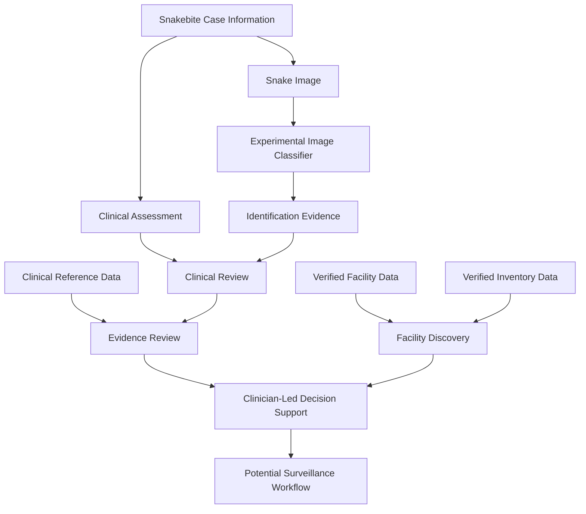

# VISHA — India Snakebite AI Decision-Support & Surveillance System

**An AI-assisted clinical decision-support and epidemiological surveillance platform for snakebite management in India.**

VISHA is a research and development project exploring how machine learning, clinical information, snake taxonomy, geospatial data and verified medical references can be integrated into a unified snakebite decision-support system.

The project aims to help healthcare professionals assess snakebite cases, examine available identification evidence, consult clinical references and access relevant facility information through a structured software platform.

> **⚠️ Research prototype:** VISHA is not a certified medical device and must not replace qualified healthcare professionals, emergency treatment, established clinical protocols or expert toxicology advice. Its AI predictions are experimental and have not been clinically validated.

---

## 🎯 Project Objectives

Snakebite envenoming is an important public health challenge in India. Appropriate management can require timely clinical assessment, laboratory investigations, access to treatment and consideration of the likely snake involved.

VISHA aims to bring together these different sources of information in one extensible system.

The main objectives are to:

* Develop an AI-assisted pipeline for snake image analysis.
* Explore snake taxonomy identification using image and reference data.
* Organise clinical symptoms, examination findings and laboratory information.
* Provide structured access to snakebite clinical guidelines and antivenom references.
* Support hospital and healthcare facility discovery using geographic information.
* Develop traceable workflows for clinical assessment and review.
* Establish a foundation for epidemiological surveillance and reporting.
* Improve transparency about model limitations, missing information and identification uncertainty.

## ✨ Key Components

### 1. Snake Image Classification

The project includes an experimental image-classification pipeline built around EfficientNet-B3.

The current documented binary model distinguishes between two classes:

* `venomous`
* `non_venomous`

The repository also contains scripts and configuration for developing and evaluating taxonomy-classification models.

**Important:** Binary classification does not establish a snake's family, genus or species. Taxonomic identification requires a separately developed and appropriately evaluated model or other reliable evidence.

### 2. Clinical Assessment

The backend contains schemas, API routes and service components for structured snakebite assessment.

The intended workflow supports the organisation of information such as:

* Reported symptoms and clinical findings.
* Bite-related information.
* Available laboratory results.
* Assessment and review status.
* Evidence required for further clinical evaluation.

Clinical findings must be interpreted by qualified healthcare professionals. Missing laboratory results or clinical information must not be treated as evidence that envenomation is absent.

### 3. Clinical References and Antivenom Information

VISHA includes a structured clinical-reference component and YAML-based reference files.

The project is developing a workflow that brings together:

* Relevant clinical guidance.
* Available snake identification evidence.
* Clinical findings and laboratory information.
* Antivenom reference information.
* Facility and stock information, where verified data is available.

An image prediction alone must never be treated as sufficient evidence for selecting or administering an antivenom.

Clinical references, treatment decisions and stock records require appropriate verification before operational use.

### 4. Healthcare Facilities and Geographic Information

The backend includes facility-related schemas and services, along with geospatial database integration.

The planned facility workflow can support:

* Facility records and geographic coordinates.
* Geographic discovery and mapping.
* Facility details.
* Antivenom inventory information where connected to verified records.

Actual map results depend on valid facility data, appropriate database configuration and available geographic coordinates.

The presence of facility or inventory code does not imply that live hospital stock information is connected.

### 5. Machine Learning and Dataset Tools

The repository includes machine-learning components for model development and inference, together with scripts for preparing datasets and manifests.

These components support experimentation with:

* Dataset manifests and split preparation.
* Leakage-aware model evaluation.
* Prototype model training.
* Image inference.
* Taxonomy-classification development.
* Model and training reports.

Raw datasets, trained checkpoints and their availability depend on the local setup and applicable data-access conditions.

### 6. Web Application and API

The application uses FastAPI to expose backend functionality and serve the current static frontend.

The backend provides a foundation for integrating machine-learning inference, clinical assessment, references, facility information and other services through a common API.

The project is being developed incrementally; the presence of an API module does not mean every proposed end-to-end workflow is complete.

---

## 🏗️ System Architecture

The intended high-level workflow is illustrated below.



This diagram represents the intended integration architecture, not a claim that all components are fully operational or clinically validated.

### Technology Stack

| Component              | Technology                           |
| ---------------------- | ------------------------------------ |
| Backend API            | Python, FastAPI                      |
| Data validation        | Pydantic                             |
| Database access        | SQLAlchemy with asynchronous support |
| Database migrations    | Alembic                              |
| Geospatial integration | PostgreSQL, PostGIS, GeoAlchemy2     |
| Machine learning       | PyTorch, Torchvision                 |
| Image classification   | EfficientNet-B3-based prototype      |
| Structured references  | YAML                                 |
| Frontend               | HTML, CSS and JavaScript             |
| Testing                | Pytest                               |
| API documentation      | FastAPI / OpenAPI                    |

---

## 📂 Repository Structure

```text
VISHA/
│
├── backend/
│   ├── app/
│   │   ├── api/v1/
│   │   │   ├── clinical_assessment.py
│   │   │   ├── clinical_references.py
│   │   │   ├── facilities.py
│   │   │   ├── facility_inventory.py
│   │   │   └── ml_inference.py
│   │   │
│   │   ├── core/
│   │   ├── db/
│   │   │   └── models/
│   │   ├── schemas/
│   │   ├── services/
│   │   └── main.py
│   │
│   ├── alembic/
│   ├── tests/
│   │   └── unit/
│   ├── alembic.ini
│   ├── requirements.txt
│   └── requirements-ml.txt
│
├── frontend/
│   └── public/
│       └── index.html
│
├── data/
│   ├── antivenom/
│   ├── clinical_references/
│   └── manifests/
│
├── ml/
│   ├── config/
│   ├── models/
│   ├── scripts/
│   └── training/
│
├── docs/
│   └── TAXONOMY_MODEL_PHASE1.md
│
├── .env.example
├── FINAL_STATUS.md
├── TRAINING_SUMMARY.md
├── README.md
└── verify_inference.py
```

This is a representative overview. Other repository files support dataset preparation, configuration, testing and development.

---

## 🧠 Current Machine-Learning Status

The documented binary-classification experiment used an EfficientNet-B3 architecture with pretrained ImageNet weights.

The project status report records the following results on its held-out prototype test set:

| Metric            | Reported result |
| ----------------- | --------------: |
| Accuracy          |          81.44% |
| Balanced accuracy |          81.31% |
| Macro precision   |          81.47% |
| Macro recall      |          81.31% |
| Macro F1-score    |          81.36% |
| ROC AUC           |          90.39% |

These results are reported in [`FINAL_STATUS.md`](FINAL_STATUS.md), with further details in [`TRAINING_SUMMARY.md`](TRAINING_SUMMARY.md).

### How to interpret these results

The prototype experiment used two training epochs and a specific dataset split. Its reported scores are not evidence of clinical effectiveness, real-world reliability or suitability for treatment decisions.

In particular:

* The binary model does not identify snake species.
* Its predictions must not be interpreted as a definitive clinical diagnosis.
* Dataset composition and image quality can affect performance.
* Independent validation and further testing are necessary.
* Taxonomy classification requires its own appropriate training and evaluation.
* No model output independently determines whether an antivenom should be administered.

The project aims to make these limitations explicit rather than presenting unverified capabilities as completed features.

---

## 🚀 Getting Started

The following instructions describe a local development setup on Windows using PowerShell.

### Prerequisites

Install or configure:

* Git.
* Python compatible with the project's dependencies.
* PostgreSQL with PostGIS for the geospatial database workflow.
* A Python virtual environment.
* Compatible PyTorch and Torchvision packages if you intend to run ML inference.

Database setup and ML inference dependencies may require additional configuration.

### 1. Clone the Repository

```powershell
git clone https://github.com/parth211206/VISHA.git

Set-Location VISHA
```

### 2. Create a Virtual Environment

```powershell
py -3.12 -m venv .venv

.\.venv\Scripts\Activate.ps1

python -m pip install --upgrade pip
```

Use a Python version supported by the packages available for your environment. The exact PyTorch and Torchvision installation may depend on your Python version and operating system.

### 3. Install Backend Dependencies

```powershell
python -m pip install -r backend/requirements.txt
```

To install the optional machine-learning dependencies:

```powershell
python -m pip install -r backend/requirements-ml.txt
```

If PyTorch installation fails, select compatible PyTorch and Torchvision builds for your environment before proceeding.

### 4. Configure Environment Variables

Create a local environment file:

```powershell
Copy-Item .env.example backend\.env

notepad backend\.env
```

Review the file and adjust its values for your local setup.

At a minimum, configure:

* The database connection string.
* Application and authentication secret keys.
* Local dataset paths, if required.
* The trained model checkpoint path, if inference is required.
* Other settings necessary for the features you intend to run.

The application configuration uses nested settings, so follow the environment-variable naming conventions in [`backend/app/core/config.py`](backend/app/core/config.py).

For example, settings may use names such as `APP__SECRET_KEY`, `AUTH__JWT_SECRET` and `ML__BINARY_MODEL_PATH`, while the database connection uses `DATABASE_URL`.

Replace example secrets with secure local values. Do not commit your actual `.env` file.

The example database URL assumes a development database. Create and configure your own database before running migrations.

### 5. Prepare the Database

Ensure that PostgreSQL is running, the target database exists and the required PostGIS functionality is available.

Then run:

```powershell
Set-Location backend

python -m alembic upgrade head
```

Database migrations should only be run against a correctly configured development database. Review migration contents before applying them to any existing database containing important data.

### 6. Start the Application

From the `backend` directory, run:

```powershell
python -m uvicorn app.main:app --reload --host 127.0.0.1 --port 8000
```

The development server should be accessible at:

**Application:** http://127.0.0.1:8000/

**API documentation:** http://127.0.0.1:8000/docs

**Health check:** http://127.0.0.1:8000/health

The health endpoint confirms that the API is responding. It does not, by itself, verify database connectivity, model availability or the correctness of clinical workflows.

Machine-learning inference may require a valid model checkpoint and compatible dependencies.

---

## 🧪 Running Tests

From the repository root, activate your virtual environment and run:

```powershell
Set-Location backend

python -m compileall -q app

python -m pytest tests/unit -q
```

These commands check Python compilation and execute the backend unit tests.

A passing test suite does not establish clinical validity or guarantee that every external integration is operational.

---

## 🔌 API Overview

The backend uses the `/api/v1` prefix for versioned API routes.

| Endpoint or component          | Purpose                                          |
| ------------------------------ | ------------------------------------------------ |
| `GET /health`                  | Check basic API availability                     |
| `/docs`                        | Explore the interactive OpenAPI documentation    |
| `/api/v1/ml-inference/predict` | Access the experimental image-inference endpoint |
| Clinical assessment routes     | Work with structured assessment functionality    |
| Clinical reference routes      | Access the clinical-reference component          |
| Facility routes                | Work with facility information                   |
| Facility inventory routes      | Work with facility inventory functionality       |

Consult the running API documentation for the exact HTTP methods, request schemas, response formats and currently registered routes.

The availability of a route does not imply that its underlying data source is connected or that its output is suitable for clinical use.

---

## 🗺️ Development Roadmap

The project is being developed incrementally, with an emphasis on improving both functionality and reliability.

### Clinical and AI Development

* [ ] Improve the validation of the binary classifier.
* [ ] Develop and independently evaluate taxonomy identification.
* [ ] Clearly separate image-classification output from verified identification.
* [ ] Improve uncertainty handling and identification evidence.
* [ ] Strengthen automated tests for API contracts and inference behavior.

### Clinical Reference and Antivenom Workflow

* [ ] Review clinical and antivenom references against authoritative sources.
* [ ] Improve evidence traceability.
* [ ] Define clear clinician-review states.
* [ ] Integrate verified facility stock information where available.
* [ ] Ensure that treatment-related displays never overstate the evidence.

### Facilities and Surveillance

* [ ] Complete testing of facility coordinates and map integration.
* [ ] Connect verified facility records.
* [ ] Validate geographic query behavior.
* [ ] Develop appropriate privacy safeguards for surveillance.
* [ ] Improve auditing and data-quality checks.

### Frontend and Usability

* [ ] Refine the dashboard and navigation.
* [ ] Improve assessment forms and result presentation.
* [ ] Add consistent loading, error and unavailable states.
* [ ] Improve responsive layouts and accessibility.
* [ ] Conduct browser-based functional testing.

Roadmap items should be considered incomplete until implemented and verified.

---

## 🔒 Privacy, Security and Data Handling

VISHA is a development project and should not be used to process real patient information in an unsecured environment.

Before any operational deployment:

* Implement and verify appropriate authentication and authorization.
* Protect credentials and database access.
* Define data retention and access policies.
* De-identify surveillance data where appropriate.
* Validate logging and audit mechanisms.
* Review applicable privacy and healthcare requirements.
* Test the security of all exposed endpoints.
* Obtain appropriate clinical and institutional review.

Do not commit passwords, API keys, private credentials or sensitive patient data.

Dataset access, image redistribution and clinical-reference use must comply with the relevant source licences, terms and permissions.

---

## ⚕️ Clinical Safety Disclaimer

VISHA is intended for research and software-development purposes.

It must not be used as the sole basis for:

* Diagnosing or excluding snakebite envenoming.
* Confirming a snake's species from an experimental model prediction.
* Selecting or administering antivenom.
* Delaying emergency evaluation or treatment.
* Replacing laboratory investigations or professional clinical judgement.

Snakebite management must follow established clinical protocols and the judgement of qualified healthcare professionals. All clinical references and treatment-related functionality require appropriate validation before real-world use.

---

## 🤝 Contributing

Contributions that improve correctness, reproducibility, usability, data quality, testing and safety are welcome.

When proposing changes:

1. Describe the problem and the expected behavior.
2. Keep changes focused and reviewable.
3. Add or update tests where appropriate.
4. Preserve existing API contracts unless a change is intentional.
5. Clearly distinguish implemented features from proposed functionality.
6. Avoid committing secrets, sensitive information or improperly redistributed datasets.

Please use GitHub Issues and Pull Requests to discuss proposed improvements.

---

## 📚 Project Documentation

For more information, see:

* [`FINAL_STATUS.md`](FINAL_STATUS.md) — documented machine-learning milestone and limitations.
* [`TRAINING_SUMMARY.md`](TRAINING_SUMMARY.md) — training and evaluation summary.
* [`docs/TAXONOMY_MODEL_PHASE1.md`](docs/TAXONOMY_MODEL_PHASE1.md) — taxonomy-model development documentation.
* [`backend/app/core/config.py`](backend/app/core/config.py) — application configuration.
* [`backend/tests/unit/`](backend/tests/unit/) — backend unit tests.

---

## 📄 License

A repository licence has not yet been specified. Until an appropriate `LICENSE` file is added, do not assume that the project's code, documentation or data may be redistributed or reused without permission.

---

**VISHA — Towards evidence-aware, AI-assisted snakebite decision support and surveillance in India.**
